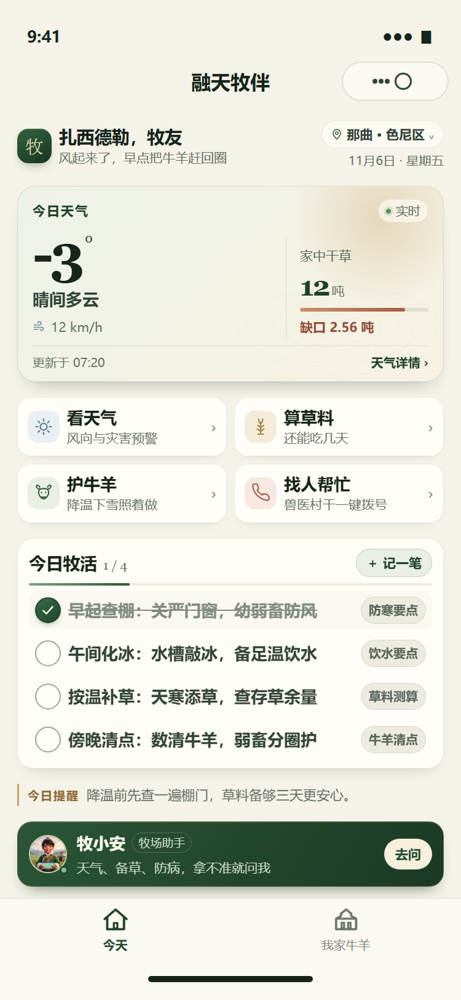
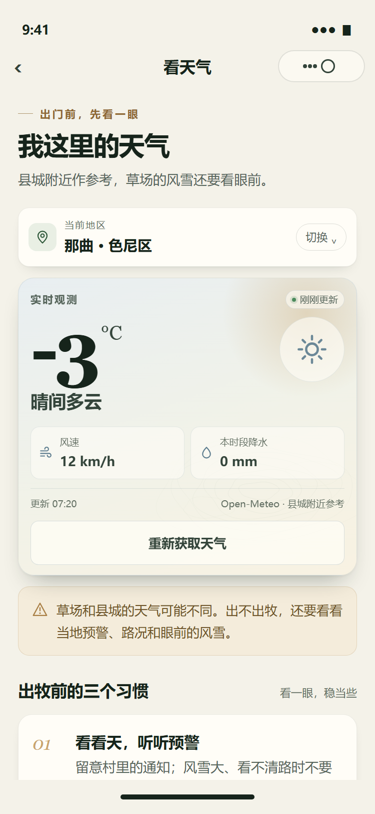
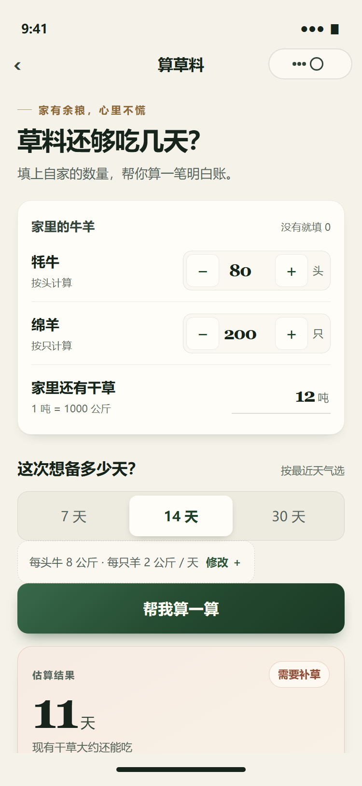
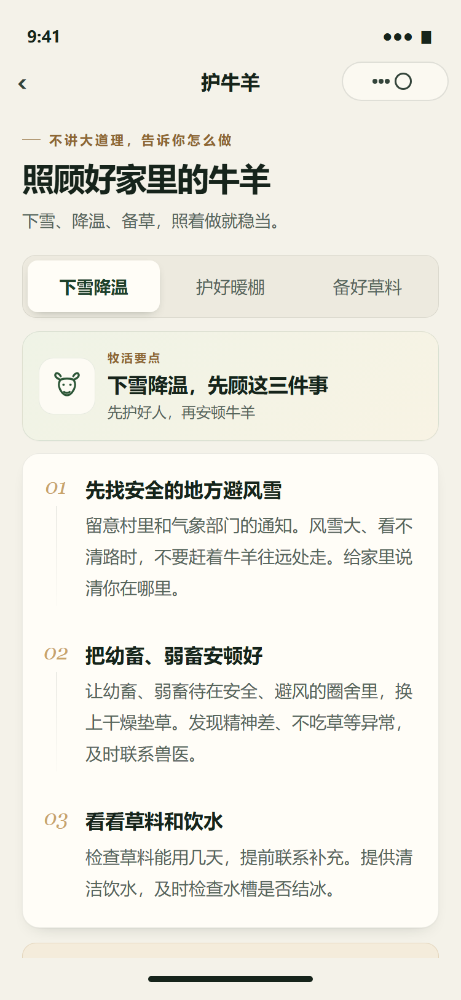
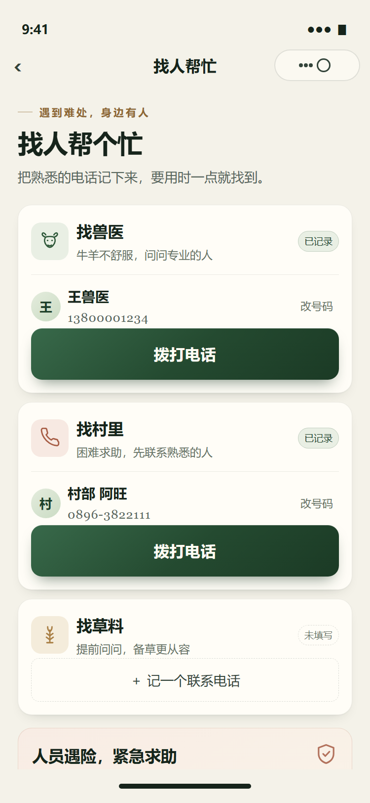
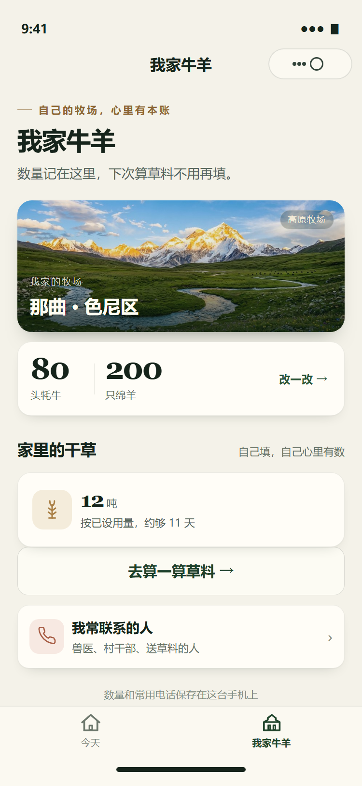
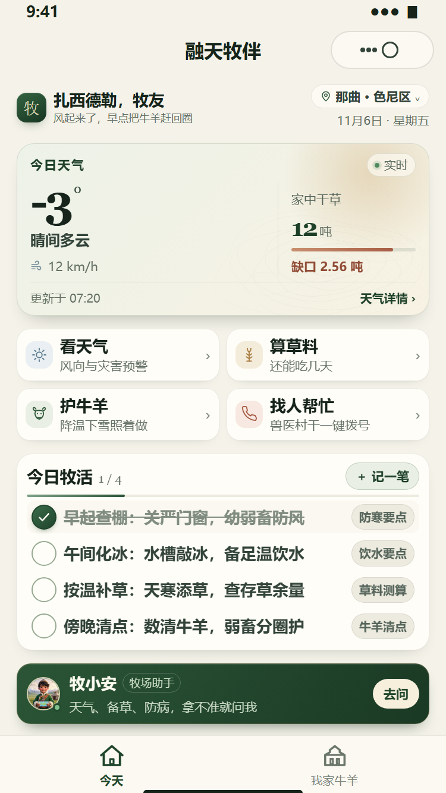

# 融天牧伴 · 牧民端微信小程序

原生微信小程序，面向高寒牧区牧民：**看天气、算草料、护牛羊、找人帮忙、今日牧活**。
不用登录注册，核心数据只保存在本机，离线也能用。

这一版前端以「高原晨光 · 编辑部质感」重做：信息层级更清楚、卡片更轻、字更大、颜色更克制，同时保留大触控热区和强光下的可读性。

## 一、本次前端改版做了什么

### 视觉体系

- **配色**：羊皮纸暖白 `#F4F2E9`、松针深绿 `#2C5637`、高原铜金 `#8E6733`，只用低饱和底色，靠细线、留白和层级撑起质感。
- **字体**：大数字（温度、牛羊头数、可吃天数）使用衬线数字并收紧字距，正文使用系统无衬线；形成「数字大、正文稳、注释轻」的三级阅读节奏。
- **图标**：全部换成自绘线性图标（牦牛、麦穗、太阳、话机、风、雨滴、盾牌等），统一 1.6 描边与 24 网格，替换原来的卡通拼贴图标。
- **纹样**：`images/ui/topo-lines.svg` 等高线纹样作为天气卡、首页态势卡的底纹，暗示草场地形，透明度很低，不抢正文。
- **层级**：1rpx 细描边 + 双层软阴影 + 24~32rpx 圆角；主按钮用深松针渐变加内高光，次按钮用纸面描边，危险动作用陶土色。
- **可读性**：正文与次要文字对比度提高到约 4.5:1；主操作高度 ≥ 88~104rpx；所有图标按钮补 `aria-label`。
- **动效**：卡片入场淡入、实时数据呼吸点、勾选时轻震动（`wx.vibrateShort`，不支持时静默跳过）、按压缩放反馈；全部为轻量 CSS 动画。

### 布局

- **今天**：顶部「品牌印章 + 扎西德勒 + 时段问候 + 地区/日期」，中间一张「今日态势卡」把天气与存草合并（左温度/天气/风速，右干草吨数与余量进度条），下面是 2×2 高频入口、今日牧活、每日提醒和牧小安常驻条。天气与存草不用来回翻页。
- **一屏全览**：主流 5.4~6.7 英寸机型一屏放下；小屏（如 iPhone SE、老款小屏安卓）自动进入紧凑模式，压缩间距与字号，仍是一屏。用户新增待办导致内容变长时，页面自然滚动，不再像旧版那样被裁掉。
- **滚动页**（看天气、算草料、护牛羊、找人帮忙、问答）：统一 `page-shell` 边距、章节标题与底部说明，长页面阅读节奏一致。

### 页面

- **今天（首页）**：今日态势卡（天气 + 干草余额进度）、四件家常事、今日牧活 4 项预置 + 自记待办、每日轮换提醒、牧小安入口。时段问候会随早晚变化。
- **看天气**：地区切换、大字号实时观测卡、风速/降水双指标、更新时间与来源、过期提示；加载骨架、失败重试、出牧前三个习惯、下雪护畜入口。
- **算草料**：牛羊步进器、干草吨数、7/14/30 天分段选择、可展开的日用量设置；结果卡用大字号「还能吃几天」+ 覆盖率进度条 + 需草/缺口明细，可一键记到「我家牛羊」。
- **护牛羊**：下雪降温 / 护好暖棚 / 备好草料三种指引，分段切换，衬线序号时间轴，结尾提示与行动按钮。
- **找人帮忙**：兽医、村里、草料三类联系人，已记录/未填写状态，拨号前二次确认；110/119/120 紧急求助区。
- **我家牛羊**：牧场照片封面、牛羊头数与干草摘要、编辑表单；编辑态自动收起封面，让表单和一屏操作更集中。
- **问问牧小安**：助手头像卡、常见问题直达、对话气泡、输入框；失败时保留问题并可重发。

## 二、运行与检查

在微信开发者工具中导入此目录即可，当前注册页面全部使用原生组件，没有 npm 组件依赖。

运行本地逻辑与链路测试：

```powershell
npm test
```

测试使用模拟 wx 环境，覆盖页面与事件绑定、导航目标、静态图片存在性、计算边界、跨页保存、保存失败、电话号码校验、拨号确认、天气缺失/过期、切换地区竞态、问答断网恢复、待办切换与统计。当前 14 项全部通过。

## 三、资源与打包

- 主包已通过 `project.config.json > packOptions.ignore` 排除未使用的大图（品牌图、旧 banner、遥感和饲草大图）、旧「新闻/方案」页面、未使用的组件目录和 `tdesign-miniprogram` 的 `miniprogram_npm`，避免主包超过 2MB 上传限制。按忽略规则估算，实际打包体积约 0.4MB。
- 牧小安头像压缩为 320×320（约 23KB），在 62~108rpx 的展示尺寸下仍清晰；牧场封面保留 900×502。
- 若后续重新启用新闻 / 方案页面或 TDesign 组件，请同步移除对应的 ignore 项。

## 四、设计预览

`docs/preview/` 下是本地按 WXML/WXSS 渲染的设计预览图（非真机截图，用于核对版式；真机效果以微信开发者工具为准）：

| 今天 | 看天气 | 算草料 | 护牛羊 |
| --- | --- | --- | --- |
|  |  |  |  |

| 找人帮忙 | 问问牧小安 | 我家牛羊 | 小屏紧凑模式 |
| --- | --- | --- | --- |
|  |  |  |  |
